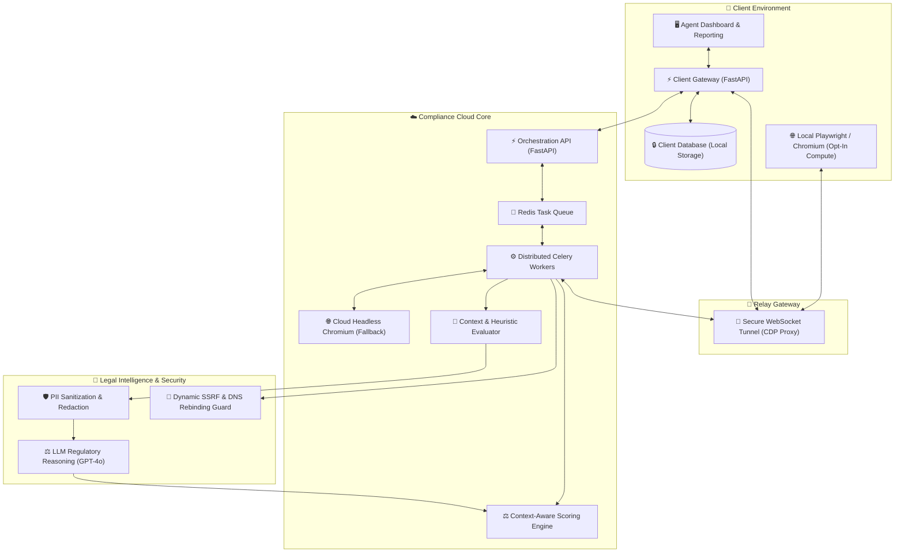

# Verdisight | Autonomous Legal, Privacy & EU AI Act Compliance Engine

## 🚀 Business Overview

**Verdisight** is an enterprise-grade, automated legal and regulatory compliance auditor for modern web platforms. By combining deep headless browser emulation with specialized Large Language Model (LLM) legal reasoning, it provides real-time, evidence-based verification of digital compliance across European and national frameworks — including **GDPR / RODO**, the **ePrivacy Directive**, the **EU AI Act**, the **Omnibus Directive**, and the **Digital Services Act (DSA)**.

Traditional compliance reviews are manual, slow, and expensive. Verdisight transforms digital compliance auditing into a continuous, deterministic, and scalable automated engineering pipeline.

### Key Value Propositions:

- **Multi-Phase Dynamic Emulation**: Simulates real user behavior across three distinct interaction states (`Baseline`, `Decline`, and `Accept`) using Playwright/Chromium to catch premature tracking and post-rejection data leaks.
- **AI-Powered Legal Clause Verification**: Employs fine-tuned LLM evaluators to analyze privacy policies and terms of service against specific regulatory requirements (e.g., GDPR Art. 13, abusive consumer clauses, DPO appointment rules, cross-border EEA data transfers).
- **Context-Aware Compliance Engine**: Automatically recognizes website context (e.g., e-commerce, lead generation, digital service, editorial) to dynamically eliminate false positives and only score legally applicable obligations.
- **Privacy-First Hybrid SaaS Architecture**: Features a proprietary WebSocket Relay tunnel architecture that allows scanning compute to execute within the client's internal network perimeter while safeguarding core intellectual property and AI heuristics.
- **Granular Consent & Dark Pattern Auditing**: Inspects Consent Management Platforms (CMPs) down to the computed CSS and toggle states, detecting pre-ticked opt-out checkboxes, deceptive UI hierarchies, and Server-Side Tracking (SST).

---

## 🏗️ System Architecture & Workflow

Verdisight utilizes a distributed, hybrid client-cloud architecture built for high throughput, absolute client data privacy, and robust security isolation.

### High-Level Technical Architecture

### 🧠 Core Inspection & AI Workflows

1. **3-Phase Dynamic Browser Inspection**:
   - **Phase 1 (Baseline)**: Headless Chromium navigates to the target domain without user interaction. Captures baseline cookies, local/session storage items, third-party network calls, and layout snapshots.
   - **Phase 2 (Decline / Granular Settings)**: Locates and opens the CMP consent settings panel to audit category toggle states (Necessary, Functional, Analytics, Marketing), ensuring non-essential categories are not pre-selected. It then triggers "Reject All" / "Decline" and audits post-decline tracking leakage and UI dark patterns.
   - **Phase 3 (Accept)**: Launches a fresh, isolated browsing context, triggers "Accept All", and maps the delta of permitted beacons, scripts, and cookies.

2. **Automated Legal Document Reasoning**:
   - The engine automatically discovers Privacy Policy and Terms of Service endpoints.
   - Raw legal documents are scrubbed via a specialized **PII Sanitizer** to protect personal data before reaching the AI model.
   - The reasoning pipeline evaluates legal text for mandatory GDPR disclosures (Controller identity, legal basis, data retention schedules, DPO presence, third-country transfers under Art. 44–49) and verifies consumer rights compliance (statutory warranty distinction, return rights, unfair contract terms).

3. **Server-Side Tracking (SST) & Evasion Detection**:
   - Compares DOM tracking pixels and script tags against actual outbound network traffic to detect disguised server-side tracking proxies and bypass attempts.

4. **Context-Aware Scoring & Penalty Normalization**:
   - The engine classifies the target site (presence of e-commerce carts, pricing tables, registration forms, AI chatbots).
   - Rules like the 30-day Omnibus price disclosure or consumer contract clauses are dynamically toggled off for non-transactional websites, avoiding inaccurate penalties.

---

## 🏗️ Engineering Challenges & Logical Solutions

### 1. Zero-Data-Leakage Hybrid Architecture via WebSocket CDP Tunneling
**Challenge**: Enterprise clients need comprehensive compliance audits behind firewalls or on local networks, without sending sensitive domestic network traffic to an external cloud or opening inbound firewall ports.
**Solution**: Designed a reverse WebSocket Relay broker inspired by ngrok/frp. The lightweight client agent opens an outbound long-lived control connection to the broker. When a scan is dispatched, the cloud Celery worker connects to the client's local headless browser instance via the tunnel using Chrome DevTools Protocol (CDP). All browsing compute and IP identity remain entirely within the client's network, while proprietary heuristics and scoring algorithms remain secure in the cloud.

### 2. High-Accuracy Dark Pattern & CMP Toggle Detection
**Challenge**: Modern websites use hundreds of custom and third-party Consent Management Platforms (OneTrust, Cookiebot, Usercentrics, Axeptio, etc.) with asynchronous rendering, shadow DOMs, and subtle manipulative designs.
**Solution**: Built a multi-layered detection engine that combines vendor-specific selectors with semantic NLP fallbacks. The system evaluates computed CSS styles (font sizing, color contrast ratios against WCAG 2.1 AA standards, visual button hierarchy) to detect deceptive patterns where "Accept" is emphasized over an obscured or hidden "Reject" option.

### 3. Contextual Compliance to Eliminate False Positives
**Challenge**: Strict regulatory rules cannot be universally applied to all web properties (e.g., flagging a personal blog or B2B portfolio for missing consumer warranty terms or Omnibus 30-day price reductions).
**Solution**: Created a contextual heuristics pipeline (`detect_page_context`) that probes the DOM for product listings, checkout flows, pricing indicators, newsletters, and user registration forms. The scoring algorithm (`penalty_calculator`) dynamically maps findings against detected contexts, omitting irrelevant requirements from the final compliance ratio.

### 4. Resilient Security: SSRF & PII Redaction
**Challenge**: Crawling arbitrary client-supplied URLs exposes cloud workers to Server-Side Request Forgery (SSRF) and DNS rebinding attacks, while feeding legal texts into LLMs risks unauthorized data leakage.
**Solution**: Implemented a two-stage SSRF defense: static domain resolution validation at submission time and per-request socket re-validation during runtime to neutralize DNS rebinding. Before forwarding legal policy texts to the AI model, an in-memory PII Sanitizer redacts emails, telephone numbers, and individual personal identifiers.

---

## 🛠️ Technology Stack

- **Backend & Cloud Orchestration**: Python 3.11+, FastAPI, Celery, Redis, SQLAlchemy.
- **Browser Automation & Network Interception**: Playwright, Chromium, Chrome DevTools Protocol (CDP), AsyncIO.
- **AI & Regulatory Intelligence**: OpenAI API (GPT-4o / GPT-4o-mini), Structured JSON Output Parsing, Prompt Engineering.
- **Consent & Legal Heuristics**: Custom CMP Parser (OneTrust, Cookiebot, Usercentrics, Axeptio, Quantcast, TrustArc), WCAG 2.1 Contrast Evaluator.
- **Infrastructure & Networking**: Docker, Docker Compose, WebSocket Reverse Tunneling, Alembic, Nginx.
- **Testing & Quality Assurance**: Pytest, End-to-End Integration Tests with mock HTML fixtures and sandboxed HTTP servers.

---

## 🚧 Status: Production-Grade System

The core compliance engine, hybrid agent relay, and multi-phase regulatory scanners are fully implemented, verified, and operational. 

Check this out at: verdisight.ppl

---

> [!NOTE]  
> This file is a **Public Showcase Portfolio Overview**. It highlights high-level architecture, automated compliance engineering patterns, and distributed system design without exposing proprietary business logic or private credentials.

